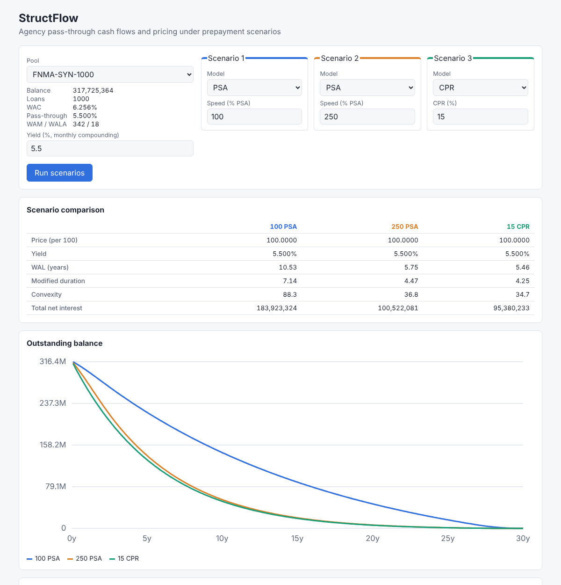

# StructFlow

Securitization cash flow and pricing service for agency MBS pass-throughs.
It projects monthly pool cash flows from loan-level data under PSA or CPR
prepayment scenarios and computes price, yield, WAL, modified duration and
convexity.

- **`structflow/`**: the pricing library, a separately installable,
  versioned package (NumPy/pandas, no web or database imports).
- **`api/`**: Flask REST service, Postgres schema with Alembic migrations, a
  loan tape ingestion CLI and the nightly repricing batch. It calls the same
  library functions as the batch.
- **`web/`**: React/TypeScript structurer view: pick a pool, compare three
  prepayment scenarios side by side, with a balance chart and the monthly cash
  flow table.
- **`docs/domain.md`**: the finance in plain English (pass-through mechanics,
  amortization, fees, CPR/SMM, PSA, price/yield, WAL, duration).
- **`bench/`**: projection benchmark, vectorized vs naive loop.



## Quick start (Docker)

```bash
docker compose up --build -d          # db, api (runs migrations), web
docker compose exec api structflow ingest data/synthetic_pool_1000.csv \
    --name FNMA-SYN-1000 --pass-through-rate 0.055
docker compose exec api structflow load-curve data/ust_curve.csv
docker compose run --rm batch         # nightly reprice, run once by hand
```

- UI: http://localhost:8080
- API: http://localhost:8000, interactive docs at http://localhost:8000/docs
  (OpenAPI document at `/openapi.json`)

To run the batch nightly, schedule `docker compose run --rm batch` (cron,
Kubernetes CronJob or similar), e.g. `30 1 * * 1-5`.

## Local development

```bash
python -m venv .venv && . .venv/bin/activate
pip install -r requirements-dev.txt

# Library
pytest structflow
python bench/benchmark_projection.py

# API (needs Postgres; DATABASE_URL defaults to structflow:structflow@localhost/structflow)
cd api
alembic upgrade head
structflow ingest ../data/synthetic_pool_1000.csv --name FNMA-SYN-1000 --pass-through-rate 0.055
structflow load-curve ../data/ust_curve.csv
flask --app structflow_api:create_app run -p 8000
pytest                                  # SQLite in memory; no Postgres needed

# Web (proxies /api to localhost:8000)
cd web && npm install && npm run dev
npm test
```

## Library

```python
from structflow import PSA, LoanTape, Pool, analytics_from_price, project_cashflows

pool = Pool(balance=1_000_000, wac=0.065, wam=360, pass_through_rate=0.06)
cf = project_cashflows(pool, PSA(150))  # pandas DataFrame, one row per month
analytics_from_price(cf, 101.5)  # price, yield, WAL, mod duration, convexity

tape = LoanTape(
    balance=[...], note_rate=[...], remaining_term=[...], age=[...], pass_through_rate=0.055
)  # loan-level projection, summed to the pool
```

Conventions: rates are annual decimals; yields compound monthly; prices are
per 100 of current face; settlement is on a payment date with no payment delay;
duration and convexity are static (cash flows held fixed). `docs/domain.md`
explains each choice.

**How the projection is vectorized.** For a level-payment loan, the balance
after `t` months is `B0 * S_t * Q_t`, where `S_t` is the scheduled
amortization factor and `Q_t` the cumulative survival from prepayments
(`prod(1 - SMM)`). Prepayments do not change the amortization shape because
the payment is recast over the same remaining term. That turns the
month-by-month recursion into array arithmetic on a (loans x months) grid,
with balance-weighted sums over loans done as matrix-vector products.
`project_cashflows_naive` keeps the textbook loop as an independent check.

## API

| Method | Path | Body / query | Returns |
|---|---|---|---|
| `GET` | `/pools` | | pools with summary (balance, WAC, WAM, WALA) |
| `POST` | `/pools` | `name`, `pass_through_rate`, `loans[]` | created pool (201) |
| `GET` | `/pools/{id}` | | pool |
| `POST` | `/pools/{id}/cashflows` | `{"model": "PSA", "speed": 150}` | monthly rows and WAL |
| `POST` | `/pools/{id}/price` | scenario plus exactly one of `yield` or `price` | price, yield, WAL, duration, convexity; recorded as a run |
| `GET` | `/pools/{id}/scenarios` | `?yield=` or `?price=` (default: yield = coupon) | the same analytics across 0 to 500 PSA |

CPR speeds are percentages (`{"model": "CPR", "speed": 8}` is 8% CPR), so both
models take the same kind of number. Requests are validated with pydantic.
Errors share one shape:

```json
{"error": {"code": "validation_error", "message": "request failed validation",
           "details": [{"loc": ["loans", 0, "balance"], "msg": "Input should be greater than 0"}]}}
```

Status codes: `400` body is not JSON, `404` unknown pool, `409` duplicate pool
name, `422` validation failure or an input the math cannot handle (for example
a price no yield can reach).

```bash
curl -s -XPOST localhost:8000/pools/1/price -H 'content-type: application/json' \
     -d '{"model": "PSA", "speed": 150, "price": 101.5}'
# {"price":101.5,"yield":0.05253,"wal":8.38,"modified_duration":6.07,"convexity":65.7,...}
```

## Database and batch

Tables (`api/migrations/versions/0001_initial_schema.py`):

- `pools`: name, pass-through rate and the balance-weighted summary computed
  at ingestion;
- `loans`: loan-level tape (balance, note rate, remaining term, age);
- `rate_curves`, `rate_curve_points`: named curves by as-of date;
- `runs`: every API price request and batch result, with inputs and the
  library version that produced it.

`structflow ingest` validates a CSV through the same pydantic schema as
`POST /pools`. `data/synthetic_pool_1000.csv` is a 1,000-loan synthetic pool
(`structflow generate-pool` recreates it deterministically).
`data/ust_curve.csv` is an **illustrative** curve, not market data.

`structflow reprice` is the nightly batch: for every pool it projects cash
flows at the base case (150 PSA), reads the curve rate at the pool's WAL from
the latest curve on or before the run date, adds a spread (100 bp by default)
and prices at that yield. Re-running for the same date replaces that date's
results, so the job is safe to retry.

## Tests

| Suite | What it covers |
|---|---|
| `structflow/tests/test_reference_cases.py` | Hand-checked cases with the arithmetic in comments: CPR/SMM, PSA ramp, month 1 of a 30-year pool (payment, interest, fees, prepayment), straight-line WAL, one-month price/yield, bullet duration and convexity, par at the coupon |
| `structflow/tests/test_properties.py` | Hypothesis: balance never negative and never rising, principal sums to the original balance, cash flow identities, higher CPR or PSA gives shorter WAL, price falls when yield rises, `yield_from_price` inverts `price_from_yield`, vectorized equals the naive loop |
| `api/tests/` | Every endpoint including validation and error shapes, OpenAPI document, batch pricing and idempotency, CLI ingestion of 1,000 loans, and Alembic migrations producing exactly the models' schema (SQLite, plus Postgres when `TEST_POSTGRES_URL` names a throwaway database) |
| `web/src/**/*.test.ts(x)` | Vitest + Testing Library: pool loading, three-scenario comparison, tab switching, API error display, chart geometry |

`HYPOTHESIS_PROFILE=thorough pytest structflow` runs 2,000 examples per
property. CI (`.github/workflows/ci.yml`) runs ruff, mypy (strict), both
pytest suites, an end-to-end Postgres job (migrate, ingest, reprice), a
benchmark smoke run, the web type check, tests and build, and
`docker compose build`.

## Benchmark

```
$ python bench/benchmark_projection.py
pool: 10,000 loans, 360 months, 150 PSA
vectorized (NumPy):         84.6 ms
naive loop (Python):      1725.5 ms
speedup:                    20.4x
max cash flow difference: 3.58e-06 (relative to pool balance 1.1e-15)
```

Measured on a 4-core cloud container with Python 3.13 and NumPy 2. The naive
loop gets a precomputed SMM table, so the comparison measures the recursion
rather than per-call overhead.

## Scope and limitations

Kept out on purpose to keep the core correct and tested:

- no payment delay, accrued interest or settlement-date logic;
- static duration and convexity only (no rate-dependent prepayment model,
  OAS or effective duration);
- no defaults or losses (agency guarantee), no ARMs, balloons or IO periods;
- no authentication on the API.
